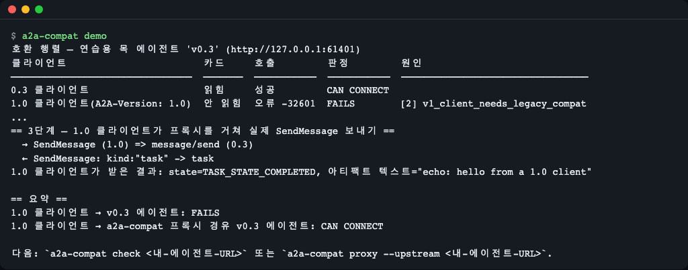
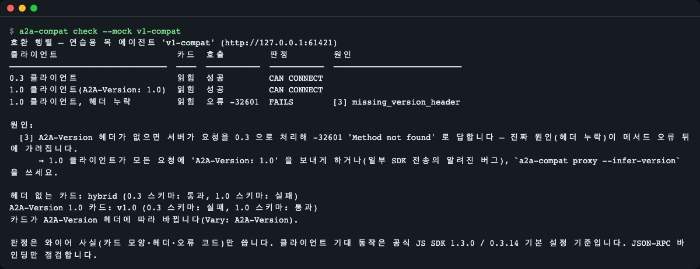
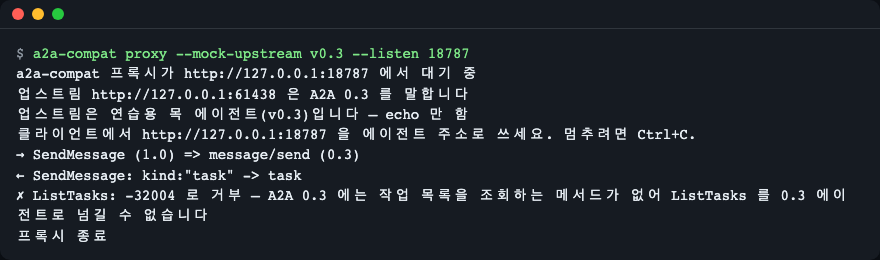
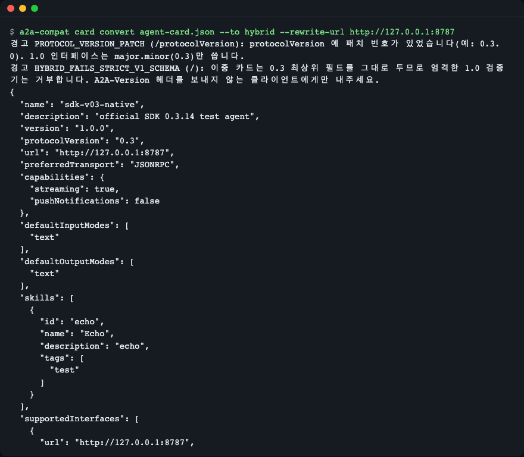
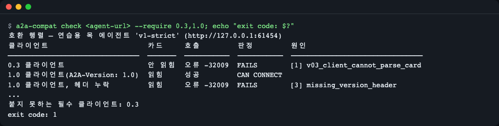
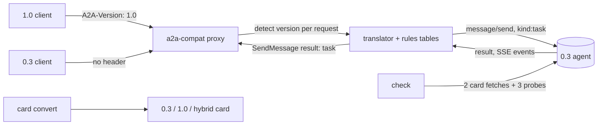

# a2a-compat

[English](README.md) | **한국어**

A2A 프로토콜 0.3 과 1.0 에이전트 사이를 점검·변환·중계하는 도구입니다. 어느 버전 클라이언트가 에이전트에 붙을 수 있는지와 안 되는 이유를 보여 주는 호환 행렬, 에이전트 카드 변환기, 그리고 요청·결과·스트림을 번역해 양쪽 코드를 고치지 않고 1.0 클라이언트와 0.3 에이전트(또는 그 반대)를 이어 주는 로컬 프록시를 제공합니다.


*`a2a-compat demo`: 프록시 전에는 1.0 클라이언트가 0.3 에이전트에 FAILS, 프록시 후에는 CAN CONNECT. 모두 오프라인 연습용 목 에이전트로 동작합니다.*

## 이런 분께

- 내 에이전트는 A2A 1.0 으로 올렸는데, 고칠 수 없는 파트너 에이전트가 아직 0.3 인 경우(또는 반대).
- 1.0 클라이언트가 `No compatible transport found` 를 내거나, 1.0 서버가 `-32601 Method not found: SendMessage` 로 답하는데 이유를 모르는 경우.
- 내 에이전트가 0.3 또는 1.0 클라이언트에서 닿지 않게 되면 CI 가 실패하게 하고 싶은 경우.

## 설치

Node.js 20 이상이 필요합니다(`brew install node`, 또는 https://nodejs.org). 최소 리눅스 이미지에서는 소스 빌드나 아래 프록시 예제를 따라 할 때만 `git` 과 `curl` 이 추가로 필요합니다.

```bash
npm install -g a2a-compat     # npm 에 올라간 뒤
# 또는 소스에서 빌드:
git clone https://github.com/LeeGyeongPil/a2a-compat && cd a2a-compat
npm install && npm run build   # 이후 실행: node dist/cli/main.js <명령>
```

아래 예시는 `a2a-compat` 로 적었습니다. 소스 체크아웃에서는 `node dist/cli/main.js` 로 바꿔 쓰세요.

## 빠르게 시작하기

```bash
npm start        # 소스 체크아웃: 빌드 후 `a2a-compat demo` 실행 (또는: a2a-compat demo)
```

데모는 localhost 에 연습용 목 에이전트 3개를 띄워 각각 점검하고, 0.3 에이전트 앞에 프록시를 세운 뒤, 1.0 클라이언트 입장에서 실제 `SendMessage` 를 보내고 다음으로 끝납니다.

```
== Summary ==
1.0 client → v0.3 agent: FAILS
1.0 client → v0.3 agent via a2a-compat proxy: CAN CONNECT
```

(한국어 화면에서는 요약 줄이 `1.0 클라이언트 → v0.3 에이전트: FAILS` / `1.0 클라이언트 → a2a-compat 프록시 경유 v0.3 에이전트: CAN CONNECT` 로 나옵니다.) 약 2초 걸리고 네트워크도 키도 필요 없습니다.

**연습용 목(mock) 모드.** 에이전트 3종(`v0.3`, `v1-strict`, `v1-compat`)은 글자를 되돌려 주기만 합니다. 와이어 동작(카드 모양, `A2A-Version` 처리, 오류 코드)은 공식 JS SDK 1.3.0·0.3.14 서버를 측정한 값을 따르지만 그 서버 자체는 아닙니다. 실제 결과는 `check`·`proxy` 에 실제 에이전트 URL 을 주세요. 실제 에이전트는 모델을 부르므로 즉답하는 목보다 느릴 수 있어 필요하면 `--timeout` 을 늘리세요.

## 0.3 과 1.0 에서 바뀐 것

| 영역 | 0.3 | 1.0 |
|---|---|---|
| 에이전트 카드 | 최상위 `url`, `protocolVersion`, `preferredTransport` | `supportedInterfaces: [{url, protocolBinding, protocolVersion}]` |
| 메서드 이름 | `message/send`, `tasks/get`, `tasks/cancel` | `SendMessage`, `GetTask`, `CancelTask` |
| 스트리밍 메서드 | `message/stream`, `tasks/resubscribe` | `SendStreamingMessage`, `SubscribeToTask` |
| 열거값 | `completed`, 역할 `user` | `TASK_STATE_COMPLETED`, `ROLE_USER` |
| 파트 | `{"kind":"text","text":"hi"}` | `{"text":"hi"}` (`kind` 없음) |
| 결과 | `{"kind":"task", ...}` | `{"task": {...}}` 래퍼(`SendMessage`·스트림 이벤트. `GetTask` 는 Task 를 그대로 돌려줌) |
| 버전 협상 | 없음 | `A2A-Version: 1.0` 헤더, 헤더가 없으면 0.3 |

플러그 모양이 다른 두 세대의 전화기를 떠올리세요. 같은 통화를 실어 나르지만 어댑터 없이는 꽂히지 않습니다. 프록시가 그 어댑터입니다.

## 사용법

| 명령 | 하는 일 |
|---|---|
| `check <에이전트-URL>` | 카드를 두 번 받고 부작용 없는 탐침(존재할 수 없는 작업 ID)을 보냅니다. 어느 버전 클라이언트가 붙을 수 있는지와 안 되는 이유를 출력합니다. |
| `check --mock <종류>` | 내장 연습용 에이전트(`v0.3`, `v1-strict`, `v1-compat`)를 같은 방식으로 점검합니다. |
| `card validate <파일\|URL>` | 카드 버전(`v0.3`, `v1.0`, `hybrid`, `unknown`)을 판별하고 번들 스키마 두 개로 검증합니다. |
| `card convert <파일\|URL> --to 0.3\|1.0\|hybrid` | 카드를 변환합니다. 경고는 고정 코드와 함께 stderr 로 나옵니다. |
| `proxy --upstream <에이전트-URL>` | 고칠 수 없는 에이전트 앞에 로컬 변환 프록시를 띄웁니다. |
| `demo` | 연습용 목 에이전트로 오프라인 둘러보기. |

공통 옵션: `--json`(기계가 읽는 출력, 키는 항상 영어), `--lang en|ko`, `--timeout <초>`, `--header 'K: V'`(예: `Authorization`, 여러 번 가능, 기록하지 않음). 종료 코드: `0` 정상, `1` `--require` 클라이언트가 붙지 못함 또는 `--strict` 경고, `2` 사용법 오류·입력 없음·에이전트에 닿지 못함.

### 에이전트 진단하기

```bash
a2a-compat check --mock v1-compat --lang ko
```


*마지막 줄은 `-32601` 로 실패하지만 진짜 원인은 `A2A-Version` 헤더 누락입니다.*

행렬 읽는 법: 한 줄이 클라이언트 하나입니다. `카드` 는 그 클라이언트가 카드를 읽을 수 있는지, `호출` 은 탐침 호출 결과, `원인` 은 grep 할 수 있는 고정 코드입니다. JSON-RPC 오류도 HTTP 200 으로 오므로 판정은 와이어 사실(카드 모양·헤더·오류 코드)만 쓰고 HTTP 상태는 쓰지 않습니다.

| 원인 코드 | 뜻 | 보통의 해결 |
|---|---|---|
| `v03_client_cannot_parse_card` | 카드에 최상위 `url`·`protocolVersion` 이 없어 0.3 클라이언트가 읽지 못함 | 서버에서 0.3 호환을 켜거나 프록시 사용 |
| `v03_methods_rejected` | 0.3 카드인데 `tasks/get` 이 거부됨 | 0.3 JSON-RPC 처리기를 켜거나 프록시 사용 |
| `v1_client_needs_legacy_compat` | 에이전트가 0.3 만 말함 | 1.0 클라이언트의 `legacyCompat` 을 켜거나 프록시 사용 |
| `v1_client_cannot_parse_card` | 0.3 도 1.0 도 아닌 카드 | `card validate` 실행 |
| `v1_methods_rejected` | 1.0 카드인데 `GetTask` 가 거부됨 | 카드에 적힌 1.0 엔드포인트 확인 |
| `missing_version_header` | `A2A-Version` 헤더가 없어 서버가 0.3 으로 처리 | 모든 요청에 헤더를 보내거나 `proxy --infer-version` |
| `no_jsonrpc_interface` | 이 버전의 JSON-RPC 엔드포인트가 없음(REST·gRPC 는 점검하지 않음) | JSONRPC 인터페이스 추가 |
| `endpoint_unreachable` | 엔드포인트가 JSON-RPC 로 답하지 않음 | URL 과 에이전트 실행 여부 확인 |
| `send_failed` | `--probe-send` 의 실제 메시지가 실패 | 에이전트 로그 확인 |

`--probe-send` 는 실제 메시지도 보내 에이전트에 작업이 생기므로 기본은 꺼져 있습니다.

### 고칠 수 없는 에이전트 앞에 프록시 세우기

먼저 내장 연습용 v0.3 에이전트를 업스트림으로 삼아 오프라인으로 해 보세요.

```bash
a2a-compat proxy --mock-upstream v0.3 --listen 8787
```

내 에이전트에 쓸 때는 실제 주소를 줍니다(여기서는 9000 번 포트의 에이전트).

```bash
a2a-compat proxy --upstream http://localhost:9000 --listen 8787
```

클라이언트에서는 `http://127.0.0.1:8787` 을 에이전트 주소로 쓰세요. 프록시는 업스트림 카드를 읽어 버전을 알아낸 뒤 요청·단건 결과·SSE 이벤트·오류·에이전트 카드를 번역합니다. 요청마다 `A2A-Version` 헤더로 버전을 정합니다(없으면 규격대로 0.3). 업스트림이 이미 클라이언트 버전을 말하면 번역 없이 그대로 전달합니다.


*1.0 `SendMessage` 는 0.3 `message/send` 로 전달되고, 0.3 에 대응이 없는 `ListTasks` 는 `-32004` 로 거부됩니다.*

| 번역함 | `-32004` 로 거부(번역이 필요한 경우에만) |
|---|---|
| `SendMessage`, `SendStreamingMessage`, `GetTask`, `CancelTask`, `SubscribeToTask`(와 0.3 이름), SSE 스트림, 오류, 에이전트 카드 | 0.3 에이전트로 가는 `ListTasks`, 푸시 알림 설정 메서드 4종, 확장 카드 메서드. 배치 요청은 `-32600`. |

프록시는 `127.0.0.1` 에만 바인딩하며 `--host` 로 넓히면 경고를 출력합니다. `0.0.0.0` 에 바인딩할 때는 `--public-url http://<접속 가능한 주소>:8787` 도 함께 주세요. 그렇지 않으면 번역된 카드가 원격 클라이언트에게 자기 `127.0.0.1` 을 부르라고 알립니다. 업스트림은 시작할 때 고정되고, 클라이언트의 `Authorization` 헤더는 전달만 하고 저장하지 않으며, `--log-bodies` 가 없으면 본문을 기록하지 않습니다.

### 카드 변환·검증

```bash
curl -s http://127.0.0.1:8080/.well-known/agent-card.json > agent-card.json   # 또는 저장해 둔 카드 파일 사용
a2a-compat card convert agent-card.json --to hybrid --rewrite-url http://127.0.0.1:8787
```


*변환된 카드는 stdout, 고정 코드가 붙은 경고는 stderr 로 나옵니다.*

hybrid 카드는 "이 엔드포인트가 두 버전을 다 말한다"는 뜻입니다. 0.3 클라이언트에게는 유효하지만 엄격한 1.0 검증기는 거부합니다(1.0 스키마가 모르는 최상위 필드를 금지하기 때문). `--strict` 는 손실 경고가 있으면 종료 코드 1 을 냅니다.

| 경고 | 심각도 | 뜻 |
|---|---|---|
| `LOSSY_DEVICE_CODE` | lossy | OAuth2 device-code 흐름은 1.0 에만 있어 0.3 카드에서는 빠짐 |
| `LOSSY_MULTIPLE_SECURITY_SCHEMES` | lossy | OAuth2 스킴 하나에 흐름이 여러 개 선언됨, 1.0 은 첫 번째만 유지 |
| `EMPTY_TOP_LEVEL_URL` | lossy | 카드의 최상위 `url` 이 비어 있음 |
| `DROPPED_FIELD` | lossy | 대응이 없는 필드가 빠짐 |
| `SIGNATURES_INVALIDATED` | lossy | 카드를 바꾸면 서명이 더는 검증되지 않음 |
| `NO_V03_INTERFACE` | lossy | 0.3 카드가 0.3 클라이언트가 호출할 수 없는 1.0 엔드포인트를 가리킴 |
| `PROTOCOL_VERSION_PATCH` | info | `0.3.0` 을 `0.3` 으로 정규화 |
| `HYBRID_FAILS_STRICT_V1_SCHEMA` | info | 엄격한 1.0 검증기는 hybrid 카드를 거부 |
| `ASSUMES_DUAL_STACK` | info | hybrid 카드는 호환 서버이거나 프록시 뒤일 때만 사실 |

### 라이브러리로 쓰기

같은 패키지가 번역기·카드 도구·점검기·프록시를 내보냅니다. SDK 객체가 아니라 와이어 JSON 을 다룹니다.

```js
import { toV1, toV03, convertCard, startMockAgent, createProxy } from 'a2a-compat';

// 0.3 요청 -> 1.0
const req03 = { jsonrpc: '2.0', id: 1, method: 'message/send',
  params: { message: { kind: 'message', role: 'user', messageId: 'm1', parts: [{ kind: 'text', text: 'hi' }] } } };
console.log(JSON.stringify(toV1(req03)));

// 1.0 결과 -> 0.3 (원 요청 메서드가 모양을 정함)
const res1 = { jsonrpc: '2.0', id: 1, result: { task: { id: 't1', contextId: 'c1', status: { state: 'TASK_STATE_COMPLETED' } } } };
console.log(JSON.stringify(toV03(res1, { method: 'SendMessage' })));

// 카드
const card03 = { protocolVersion: '0.3.0', name: 'demo', description: 'd', url: 'https://agent.example.com/a2a', version: '1.0.0',
  capabilities: {}, defaultInputModes: ['text'], defaultOutputModes: ['text'], skills: [] };
const { card, warnings, from } = convertCard(card03, '1.0');
console.log(from, JSON.stringify(card.supportedInterfaces), warnings.map((w) => w.code));

// 연습용 목 에이전트 앞에 프록시
const agent = await startMockAgent('v0.3');
const proxy = await createProxy({ upstream: agent.url, port: 0 });
const r = await fetch(`${proxy.url}/a2a/jsonrpc`, {
  method: 'POST', headers: { 'content-type': 'application/json', 'A2A-Version': '1.0' },
  body: JSON.stringify({ jsonrpc: '2.0', id: 1, method: 'SendMessage',
    params: { message: { role: 'ROLE_USER', messageId: 'm1', parts: [{ text: 'hello' }] } } }),
});
console.log((await r.json()).result.task.status.state);
await proxy.close(); await agent.close();
```

이 스크립트를 그대로 실행한 출력:

```
{"jsonrpc":"2.0","id":1,"method":"SendMessage","params":{"message":{"role":"ROLE_USER","messageId":"m1","parts":[{"text":"hi"}]}}}
{"jsonrpc":"2.0","id":1,"result":{"kind":"task","id":"t1","contextId":"c1","status":{"state":"completed"}}}
v0.3 [{"url":"https://agent.example.com/a2a","protocolBinding":"JSONRPC","protocolVersion":"0.3"}] [ 'PROTOCOL_VERSION_PATCH' ]
TASK_STATE_COMPLETED
```

그 밖의 export: `validateCard`, `detectCardVersion`, `checkEndpoint`, `methodToV1`, `methodToV03`, `UnsupportedOperationError`, `TranslationError`.

### CI 에서 쓰기

```bash
a2a-compat check http://127.0.0.1:8080 --require 0.3,1.0 --json > compat.json
```


*필수 클라이언트가 붙지 못하면 명령이 종료 코드 1 로 끝납니다.*

[`examples/github-actions-check.yml`](examples/github-actions-check.yml) 은 에이전트를 띄우고 점검한 뒤 JSON 보고서를 아티팩트로 남기는 바로 쓸 수 있는 워크플로입니다.

## 설정

| 설정 | 기본값 | 비고 |
|---|---|---|
| `--lang en\|ko` | `A2A_COMPAT_LANG`, 그다음 `LC_ALL`, `LC_MESSAGES`, `LANG` | 한국어가 아니면 영어. `--json` 키와 판정 표기(`CAN CONNECT`, `FAILS`)는 두 언어 모두 영어 그대로 |
| `--timeout` | 10초(`check`, `card`), 120초(`proxy`) | 요청마다 네트워크 대기 시간 |
| `--idle-timeout` | 300초 | 이 시간 동안 바이트가 없는 스트림을 프록시가 닫음 |
| `--listen` / `--host` | 8787 / `127.0.0.1` | `--listen 0` 은 빈 포트 아무거나 |
| `--public-url` | 바인딩한 주소 | 번역된 카드에 적을 주소. `0.0.0.0` 바인딩이나 다른 호스트 이름 뒤에서 쓸 때 지정 |
| `--upstream-version` | `auto` | `0.3` 또는 `1.0` 으로 업스트림 버전 고정 |
| `--infer-version` | 꺼짐 | `A2A-Version` 헤더 없이 온 1.0 메서드 이름도 받아 줌 |
| `NO_COLOR=1` | | 색 없음(TTY 가 아니어도 없음) |

API 키는 필요 없습니다. 영어 화면은 다음과 같습니다.

```bash
a2a-compat check --mock v1-compat --lang en
```

## 동작 원리



- 프록시는 요청마다 `A2A-Version` 헤더를 읽어 클라이언트가 어느 버전을 말하는지 압니다.
- 번역기는 `src/rules/` 의 단순한 데이터 표로 메서드 이름·열거값·파트·결과 래퍼를 바꾸고, 모르는 필드는 보존합니다.
- 응답 모양은 원 요청 메서드에 따라 달라서 `GetTask` 는 Task 를 그대로, `SendMessage` 는 래퍼로 돌려줍니다.
- SSE 스트림은 이벤트 단위로 번역하며 버퍼링하지 않습니다. 업스트림이 이벤트 중간에 끊기면 클라이언트 스트림만 닫히고 프록시는 계속 삽니다.
- `check` 는 카드 요청 2번과, 존재할 수 없는 작업 ID 로 보내는 탐침 3번을 합니다. 그래서 `-32001` 같은 업무 오류는 "알아들음", `-32601`·`-32009`·`-32600`·`-32700` 은 "거부"로 읽습니다.

## 언제 쓰나

- 잘 맞는 경우: 한쪽을 고칠 수 없거나 고치고 싶지 않고 JSON-RPC 바인딩을 쓸 때. "누가 나에게 붙을 수 있나" 보고서와 CI 게이트로도 좋습니다.
- 코드를 직접 관리한다면 공식 JS SDK 에 프록시 대신 켤 수 있는 호환 계층(`legacyCompat`)이 있습니다: [a2a-js](https://github.com/a2aproject/a2a-js).
- 규격 적합성 시험은 공식 [a2a-tck](https://github.com/a2aproject/a2a-tck), 에이전트를 대화형으로 살펴보려면 [a2a-inspector](https://github.com/a2aproject/a2a-inspector) 를 보세요.

## 자주 겪는 문제

| 증상 | 원인 | 해결 |
|---|---|---|
| 1.0 서버가 `-32601 Method not found: SendMessage` | `A2A-Version: 1.0` 헤더가 없어 0.3 호출로 처리됨 | 헤더를 보내거나 프록시를 `--infer-version` 으로 실행 |
| 1.0 클라이언트의 `No compatible transport found` | 에이전트가 0.3 만 광고함 | `legacyCompat` 을 켜거나 프록시 주소 사용 |
| `-32009` 버전 미지원 | 서버가 1.0 만 지원하는데 0.3 호출이 옴 | 반대 방향으로 위와 같음: 프록시 사용 |
| `ListTasks` 가 `-32004` 로 거부됨 | 0.3 에는 작업 목록 메서드가 없음 | 작업 ID 별 `GetTask` 사용 |
| `check` 가 종료 코드 2 | 사용법 오류, 입력 없음, 또는 에이전트에 닿지 못함 | URL 과 에이전트 실행 여부 확인 |
| `npm run test:interop` 중 로그에 `Unhandled error ... VersionNotSupportedError` | 공식 엄격 1.0 SDK 서버가 헤더 없는 호출을 받으면 남기는 로그 | 정상입니다. SDK 자체 로그이며 테스트 실패가 아님 |

## 한계

JSON-RPC 바인딩만 다룹니다. REST·gRPC 바인딩, 푸시 알림 설정 번역, 확장 카드 메서드는 아직 구현하지 않았습니다(프록시가 `-32004` 로 거부). A2A 규격과 SDK 는 계속 바뀌고 있어, 번역 규칙은 `src/rules/` 에 두고 공식 SDK 가 주고받은 실제 메시지(`npm run capture-fixtures` 로 다시 만듦)와 대조해 확인합니다.

## 개발

```bash
npm install
npm test             # 빌드 후 기본 스위트 실행(CI 가 돌리는 것), 네트워크·키 불필요
npm run test:e2e     # CLI 자식 프로세스·시그널·EPIPE·스트림 끊김·타이머(로컬)
npm run test:interop # 공식 @a2a-js/sdk 1.3.0·0.3.14 클라이언트·서버 + express(로컬)
npm run test:all     # 세 스위트 모두
npm run ci:local     # CI 워크플로와 같은 단계를 실행. `npm ci` 로 시작하므로 node_modules 를 다시 설치함
```

CI 는 Node.js 22 에서 기본 스위트만 돌립니다. 릴리스 전에는 `npm run test:all`, SDK 버전을 올릴 때는 `npm run test:interop` 을 돌려 주세요.

버그·제안은 이슈로 남겨 주세요. 변경 기록은 [CHANGELOG.md](CHANGELOG.md).

## 출처와 라이선스

MIT, [LICENSE](LICENSE) 참고. 패키지는 Apache-2.0 JSON Schema 두 개를 수정 없이 포함합니다: [a2aproject/A2A](https://github.com/a2aproject/A2A) 의 A2A 0.3.0 스키마와 [a2a-inspector](https://github.com/a2aproject/a2a-inspector) 가 생성한 1.0 스키마(출처·체크섬은 [NOTICE](NOTICE) 와 `src/schemas/SOURCES.md`). 규격: https://a2a-protocol.org/v1.0.0/specification/ (2026-11-21 확인).
