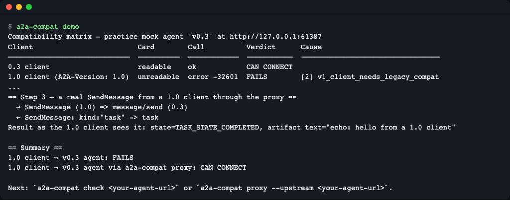
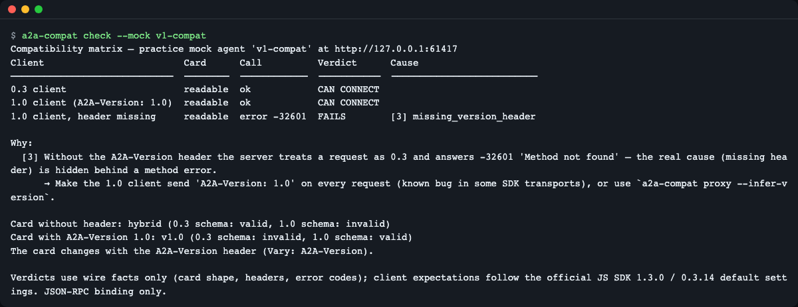
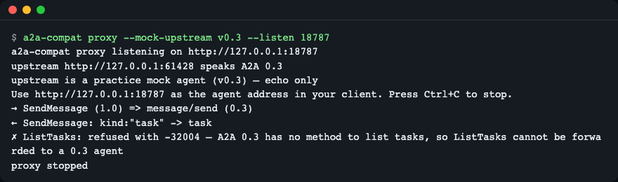
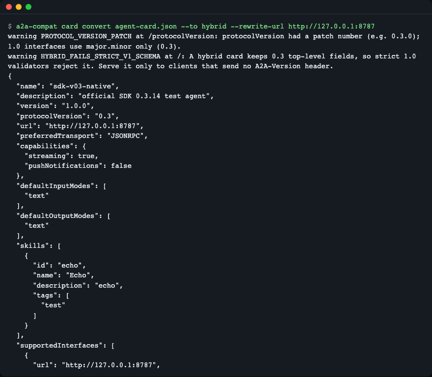
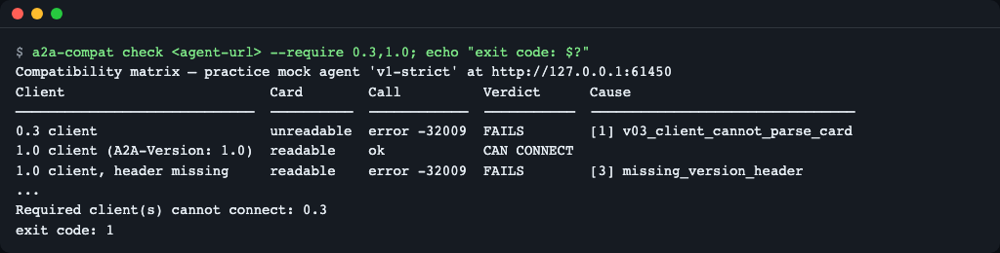
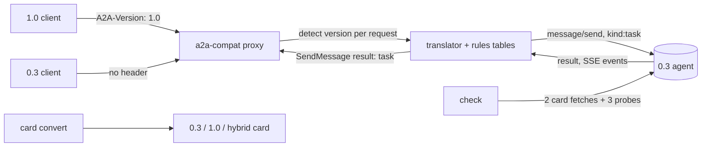

# a2a-compat

**English** | [한국어](README.ko.md)

Check, convert and proxy between A2A protocol 0.3 and 1.0 agents. You get a compatibility matrix that says which client versions can reach an agent and why not, an agent card converter, and a local proxy that translates requests, results and streams so a 1.0 client can talk to a 0.3 agent (and the other way round) without changing either side.


*`a2a-compat demo`: before the proxy the 1.0 client FAILS against a 0.3 agent, after it CAN CONNECT. Everything runs offline against practice mock agents.*

## Who is this for

- You moved your agent to A2A 1.0 and a partner agent you cannot change still speaks 0.3 (or the reverse).
- A 1.0 client says `No compatible transport found`, or a 1.0 server answers `-32601 Method not found: SendMessage` and you do not know why.
- You want a CI check that fails when your agent stops being reachable by 0.3 or 1.0 clients.

## Install

Needs Node.js 20 or newer (`brew install node`, or see https://nodejs.org). On a minimal Linux image you also need `git` and `curl` only if you build from source or follow the proxy example below.

```bash
npm install -g a2a-compat     # once the package is on npm
# or build from source:
git clone https://github.com/LeeGyeongPil/a2a-compat && cd a2a-compat
npm install && npm run build   # then run: node dist/cli/main.js <command>
```

The examples below write `a2a-compat`; from a source checkout use `node dist/cli/main.js` instead.

## Quick start

```bash
npm start        # source checkout: builds, then runs `a2a-compat demo` (or: a2a-compat demo)
```

The demo starts three practice mock agents on localhost, checks each one, puts the proxy in front of the 0.3 agent, sends a real `SendMessage` from a 1.0 point of view and ends with:

```
== Summary ==
1.0 client → v0.3 agent: FAILS
1.0 client → v0.3 agent via a2a-compat proxy: CAN CONNECT
```

It takes about two seconds and needs no network access or keys.

**Practice mock mode.** The three agents (`v0.3`, `v1-strict`, `v1-compat`) only echo text. Their wire behaviour (card shape, `A2A-Version` handling, error codes) follows measurements of the official JS SDK 1.3.0 and 0.3.14 servers, but they are not those servers. Point `check` and `proxy` at a real agent URL for real results; real agents call models and can be slower than the instant mocks, so raise `--timeout` if needed.

## What changed between 0.3 and 1.0

| Area | 0.3 | 1.0 |
|---|---|---|
| Agent card | top-level `url`, `protocolVersion`, `preferredTransport` | `supportedInterfaces: [{url, protocolBinding, protocolVersion}]` |
| Method names | `message/send`, `tasks/get`, `tasks/cancel` | `SendMessage`, `GetTask`, `CancelTask` |
| Streaming methods | `message/stream`, `tasks/resubscribe` | `SendStreamingMessage`, `SubscribeToTask` |
| Enums | `completed`, role `user` | `TASK_STATE_COMPLETED`, `ROLE_USER` |
| Parts | `{"kind":"text","text":"hi"}` | `{"text":"hi"}` (no `kind`) |
| Results | `{"kind":"task", ...}` | `{"task": {...}}` wrapper (for `SendMessage` and stream events; `GetTask` returns the Task directly) |
| Version negotiation | none | `A2A-Version: 1.0` header; a missing header means 0.3 |

Think of two phone generations with different plugs: both carry the same call, but nothing fits until an adapter sits in between. The proxy is that adapter.

## Usage

| Command | What it does |
|---|---|
| `check <agent-url>` | Fetches the card twice and sends side-effect-free probes (a task ID that cannot exist). Prints which client versions can connect and why not. |
| `check --mock <kind>` | Same, against a built-in practice agent: `v0.3`, `v1-strict`, `v1-compat`. |
| `card validate <file\|url>` | Detects the card version (`v0.3`, `v1.0`, `hybrid`, `unknown`) and validates it against both bundled schemas. |
| `card convert <file\|url> --to 0.3\|1.0\|hybrid` | Converts a card. Warnings go to stderr with fixed codes. |
| `proxy --upstream <agent-url>` | Local translating proxy in front of an agent you cannot change. |
| `demo` | Offline tour with practice mock agents. |

Common options: `--json` (machine-readable, keys always English), `--lang en|ko`, `--timeout <sec>`, `--header 'K: V'` (for example `Authorization`, repeatable, never logged). Exit codes: `0` ok, `1` a `--require` client cannot connect, or a `--strict` warning, `2` usage error, missing input or unreachable agent.

### Diagnose an agent

```bash
a2a-compat check --mock v1-compat
```


*The last row fails with `-32601`, but the real cause is a missing `A2A-Version` header.*

Reading the matrix: each row is a client. `Card` says whether that client can parse the agent card, `Call` is what the probe call returned, `Cause` is a fixed code you can grep. A JSON-RPC error still arrives with HTTP 200, so the verdict uses wire facts (card shape, headers, error codes) and never the HTTP status.

| Cause code | Meaning | Usual fix |
|---|---|---|
| `v03_client_cannot_parse_card` | The card has no top-level `url` / `protocolVersion`, so a 0.3 client cannot read it | enable 0.3 compatibility on the server, or use the proxy |
| `v03_methods_rejected` | 0.3 card, but `tasks/get` is rejected | enable the 0.3 JSON-RPC dispatcher, or use the proxy |
| `v1_client_needs_legacy_compat` | The agent only speaks 0.3 | turn on `legacyCompat` in the 1.0 client, or use the proxy |
| `v1_client_cannot_parse_card` | The card is neither a 0.3 nor a 1.0 card | run `card validate` |
| `v1_methods_rejected` | 1.0 card, but `GetTask` is rejected | check the advertised 1.0 endpoint |
| `missing_version_header` | No `A2A-Version` header, so the server treats the call as 0.3 | send the header on every request, or `proxy --infer-version` |
| `no_jsonrpc_interface` | No JSON-RPC endpoint for this version (REST and gRPC are not checked) | add a JSONRPC interface |
| `endpoint_unreachable` | The endpoint did not answer with JSON-RPC | check the URL and that the agent runs |
| `send_failed` | The real message from `--probe-send` failed | read the agent logs |

`--probe-send` also sends a real message, which creates a task on the agent; it is off by default.

### Put a proxy in front of an agent you cannot change

Try it offline first, with the built-in practice v0.3 agent as upstream:

```bash
a2a-compat proxy --mock-upstream v0.3 --listen 8787
```

For your own agent, point it at the real address instead (here an agent on port 9000):

```bash
a2a-compat proxy --upstream http://localhost:9000 --listen 8787
```

Use `http://127.0.0.1:8787` as the agent address in your client. The proxy reads the upstream card to learn its version, then translates requests, single results, SSE events, errors and the agent card. A version is chosen per request from the `A2A-Version` header (missing means 0.3, as in the spec). If the upstream already speaks the client's version, the message passes through untouched.


*A 1.0 `SendMessage` is forwarded as 0.3 `message/send`; `ListTasks` has no 0.3 counterpart and is refused with `-32004`.*

| Translated | Refused with `-32004` (only when translation would be needed) |
|---|---|
| `SendMessage`, `SendStreamingMessage`, `GetTask`, `CancelTask`, `SubscribeToTask` (and their 0.3 names), SSE streams, errors, the agent card | `ListTasks` to a 0.3 agent, the four push-notification config methods, the extended card method. Batch requests get `-32600`. |

The proxy binds to `127.0.0.1`; `--host` widens that and prints a warning. When you bind `0.0.0.0`, also pass `--public-url http://<reachable-address>:8787`, otherwise the translated card tells remote clients to call their own `127.0.0.1`. The upstream is fixed at start, client `Authorization` headers are forwarded but never stored, and bodies are not logged unless you pass `--log-bodies`.

### Convert and validate cards

```bash
curl -s http://127.0.0.1:8080/.well-known/agent-card.json > agent-card.json   # or use any saved card file
a2a-compat card convert agent-card.json --to hybrid --rewrite-url http://127.0.0.1:8787
```


*The converted card goes to stdout, warnings with fixed codes go to stderr.*

A hybrid card says "this endpoint speaks both versions". It is valid for 0.3 clients but a strict 1.0 validator rejects it (the 1.0 schema forbids unknown top-level fields). `--strict` turns lossy warnings into exit code 1.

| Warning | Severity | Meaning |
|---|---|---|
| `LOSSY_DEVICE_CODE` | lossy | The OAuth2 device-code flow exists only in 1.0 and is dropped in a 0.3 card |
| `LOSSY_MULTIPLE_SECURITY_SCHEMES` | lossy | One OAuth2 scheme declared several flows; 1.0 keeps only the first |
| `EMPTY_TOP_LEVEL_URL` | lossy | The card has an empty top-level `url` |
| `DROPPED_FIELD` | lossy | A field with no counterpart was dropped |
| `SIGNATURES_INVALIDATED` | lossy | Changing the card breaks its signatures |
| `NO_V03_INTERFACE` | lossy | A 0.3 card would point at a 1.0 endpoint that 0.3 clients cannot call |
| `PROTOCOL_VERSION_PATCH` | info | `0.3.0` is normalised to `0.3` |
| `HYBRID_FAILS_STRICT_V1_SCHEMA` | info | Strict 1.0 validators reject hybrid cards |
| `ASSUMES_DUAL_STACK` | info | A hybrid card is true only for compat-enabled servers or behind the proxy |

### Use as a library

The same package exports the translator, card tools, checker and proxy. It works on wire JSON, not on SDK objects.

```js
import { toV1, toV03, convertCard, startMockAgent, createProxy } from 'a2a-compat';

// 0.3 request -> 1.0
const req03 = { jsonrpc: '2.0', id: 1, method: 'message/send',
  params: { message: { kind: 'message', role: 'user', messageId: 'm1', parts: [{ kind: 'text', text: 'hi' }] } } };
console.log(JSON.stringify(toV1(req03)));

// 1.0 result -> 0.3 (the request method decides the shape)
const res1 = { jsonrpc: '2.0', id: 1, result: { task: { id: 't1', contextId: 'c1', status: { state: 'TASK_STATE_COMPLETED' } } } };
console.log(JSON.stringify(toV03(res1, { method: 'SendMessage' })));

// card
const card03 = { protocolVersion: '0.3.0', name: 'demo', description: 'd', url: 'https://agent.example.com/a2a', version: '1.0.0',
  capabilities: {}, defaultInputModes: ['text'], defaultOutputModes: ['text'], skills: [] };
const { card, warnings, from } = convertCard(card03, '1.0');
console.log(from, JSON.stringify(card.supportedInterfaces), warnings.map((w) => w.code));

// proxy in front of a practice mock agent
const agent = await startMockAgent('v0.3');
const proxy = await createProxy({ upstream: agent.url, port: 0 });
const r = await fetch(`${proxy.url}/a2a/jsonrpc`, {
  method: 'POST', headers: { 'content-type': 'application/json', 'A2A-Version': '1.0' },
  body: JSON.stringify({ jsonrpc: '2.0', id: 1, method: 'SendMessage',
    params: { message: { role: 'ROLE_USER', messageId: 'm1', parts: [{ text: 'hello' }] } } }),
});
console.log((await r.json()).result.task.status.state);
await proxy.close(); await agent.close();
```

Output of this exact script:

```
{"jsonrpc":"2.0","id":1,"method":"SendMessage","params":{"message":{"role":"ROLE_USER","messageId":"m1","parts":[{"text":"hi"}]}}}
{"jsonrpc":"2.0","id":1,"result":{"kind":"task","id":"t1","contextId":"c1","status":{"state":"completed"}}}
v0.3 [{"url":"https://agent.example.com/a2a","protocolBinding":"JSONRPC","protocolVersion":"0.3"}] [ 'PROTOCOL_VERSION_PATCH' ]
TASK_STATE_COMPLETED
```

Other exports: `validateCard`, `detectCardVersion`, `checkEndpoint`, `methodToV1`, `methodToV03`, `UnsupportedOperationError`, `TranslationError`.

### Use in CI

```bash
a2a-compat check http://127.0.0.1:8080 --require 0.3,1.0 --json > compat.json
```


*A required client that cannot connect makes the command exit with 1.*

[`examples/github-actions-check.yml`](examples/github-actions-check.yml) is a ready workflow that starts your agent, runs the check and keeps the JSON report as an artifact.

## Settings

| Setting | Default | Notes |
|---|---|---|
| `--lang en\|ko` | from `A2A_COMPAT_LANG`, then `LC_ALL`, `LC_MESSAGES`, `LANG` | Anything that is not Korean falls back to English. `--json` keys and verdict tokens (`CAN CONNECT`, `FAILS`) stay English in both languages. |
| `--timeout` | 10 s (`check`, `card`), 120 s (`proxy`) | Network wait per request |
| `--idle-timeout` | 300 s | Proxy closes a stream that sends no bytes for this long |
| `--listen` / `--host` | 8787 / `127.0.0.1` | `--listen 0` picks a free port |
| `--public-url` | bound address | Address written into the translated card; set it when binding `0.0.0.0` or running behind another host name |
| `--upstream-version` | `auto` | `0.3` or `1.0` forces the upstream version |
| `--infer-version` | off | Accept 1.0 method names that arrive without an `A2A-Version` header |
| `NO_COLOR=1` | | No colours (also none when not a TTY) |

No API keys are needed. The Korean screen:

```bash
a2a-compat check --mock v1-compat --lang ko
```

## How it works



- The proxy reads the `A2A-Version` header of each request to know which version the client speaks.
- The translator maps method names, enums, parts and result wrappers using plain data tables in `src/rules/`; unknown fields are kept.
- The response shape depends on the original request method, so `GetTask` returns a bare Task while `SendMessage` returns a wrapper.
- SSE streams are translated event by event, never buffered; if the upstream cuts off mid-event the client stream closes and the proxy keeps running.
- `check` makes two card requests and three probes with a task ID that cannot exist, so a business error like `-32001` means "understood" and `-32601`, `-32009`, `-32600`, `-32700` mean "rejected".

## When to use it

- Good fit: you cannot or do not want to modify one side, and the agents use the JSON-RPC binding. Also good for a quick "who can reach me" report and as a CI gate.
- If you own the code, the official JS SDK has its own compatibility layer (`legacyCompat`) that you can enable instead of a proxy: [a2a-js](https://github.com/a2aproject/a2a-js).
- To test spec conformance of an agent, see the official [a2a-tck](https://github.com/a2aproject/a2a-tck); to inspect an agent interactively, see [a2a-inspector](https://github.com/a2aproject/a2a-inspector).

## Troubleshooting

| Symptom | Cause | Fix |
|---|---|---|
| `-32601 Method not found: SendMessage` from a 1.0 server | The `A2A-Version: 1.0` header is missing, so the call is treated as 0.3 | Send the header, or start the proxy with `--infer-version` |
| `No compatible transport found` in a 1.0 client | The agent only advertises 0.3 | Turn on `legacyCompat`, or use the proxy address |
| `-32009` version not supported | The server only supports 1.0 and got a 0.3 call | Same as above in the other direction: use the proxy |
| `ListTasks` refused with `-32004` | 0.3 has no method to list tasks | Use `GetTask` per task ID |
| Exit code 2 from `check` | Wrong usage, missing input, or the agent is unreachable | Check the URL and that the agent runs |
| `Unhandled error ... VersionNotSupportedError` in the logs during `npm run test:interop` | The official strict 1.0 SDK server logs it when it receives a call without a header | Expected; it is the SDK's own log, not a test failure |

## Limitations

Only the JSON-RPC binding is covered. REST and gRPC bindings, push-notification config translation and the extended card method are not implemented yet (the proxy refuses them with `-32004`). The A2A spec and SDKs are still changing; the translation rules live in `src/rules/` and are checked against captured official SDK traffic (`npm run capture-fixtures` regenerates it).

## Development

```bash
npm install
npm test             # builds, then runs the default suite (what CI runs); no network or keys needed
npm run test:e2e     # CLI child processes, signals, EPIPE, stream cut-offs, timers (local)
npm run test:interop # official @a2a-js/sdk 1.3.0 and 0.3.14 clients and servers + express (local)
npm run test:all     # all three suites
npm run ci:local     # runs the same steps as the CI workflow; starts with `npm ci`, which reinstalls node_modules
```

CI runs only the default suite, on Node.js 22. Run `npm run test:all` before a release and `npm run test:interop` whenever you bump an SDK version.

Report bugs and ideas as issues. Changes are listed in [CHANGELOG.md](CHANGELOG.md).

## Credits and license

MIT, see [LICENSE](LICENSE). The package bundles two JSON Schema files unchanged under Apache-2.0: the A2A 0.3.0 schema from [a2aproject/A2A](https://github.com/a2aproject/A2A) and the 1.0 schema generated by [a2a-inspector](https://github.com/a2aproject/a2a-inspector) (details and checksums in [NOTICE](NOTICE) and `src/schemas/SOURCES.md`). Specification: https://a2a-protocol.org/v1.0.0/specification/ (checked 2026-11-21).
